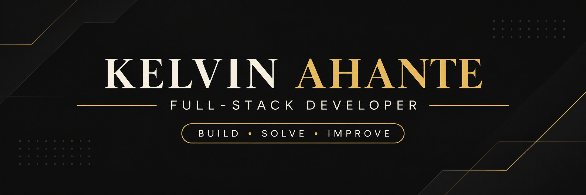

<!-- BANNER -->

  

<h1 align="center">Hey, I'm Kelvin 👋</h1>

<h3 align="center">Full-Stack Developer | Web Applications | Digital Products</h3>

  Building useful things, solving problems and turning ideas into reality.

---

## About Me

I'm a Full-Stack Developer with **over 5 years of experience** building websites, web applications and digital solutions.

I enjoy working across the stack, from crafting intuitive interfaces to developing the logic and systems behind them. I'm particularly interested in building products that solve real-world problems, improving business processes through technology and creating digital experiences that people actually enjoy using.

Beyond writing code, I enjoy exploring new technologies, experimenting with ideas and finding better ways to approach problems.

- Building web applications and digital products.
- Interested in software engineering, problem-solving and product development.
- I appreciate clean interfaces, thoughtful design and maintainable code.
- Currently learning Python and expanding my engineering toolkit.
- Open to interesting projects and meaningful collaborations.

## Tech Stack

**Frontend**

  

**Backend**

  

**CMS, Platforms & Tools**

  

**Currently Exploring**

  

## Selected Projects

### [Jos Marketplace](https://jos-marketplace.vercel.app/)

A full-stack marketplace connecting vendors with customers in Jos, Plateau State. Built to help local businesses reach more customers through online storefronts, product listings and integrated transactions.

Features include vendor storefronts, product management, customer-vendor communication and payment processing.

`MongoDB` `Express` `React` `Node.js`

### [Hotel Website Demo](https://demo-hotel-website-teal.vercel.app/)

A modern hotel website focused on premium hospitality presentation, responsive design and intuitive booking experiences. Built with attention to visual detail, usability and the overall guest experience.

`Next.js` `TypeScript` `Tailwind CSS`

### [Child Immunisation Record System](https://child-immunization-record-system.netlify.app/)

A web-based application for managing child immunisation records, built to support organised record keeping and easier access to immunisation information.

`React` `PHP`

[View source code](https://github.com/kiviekelvin/child-immunisation-record-system)

## Beyond the Code

I enjoy the process of figuring things out, experimenting with ideas and building things that have a purpose.

I'm always interested in connecting with people who enjoy creating, learning and solving interesting problems.

## Let's Connect

  <a href="https://kiviekelvin.github.io/my-portfolio-website/">Portfolio</a> ·
  <a href="https://www.linkedin.com/in/kelvin-ahante/">LinkedIn</a> ·
  <a href="mailto:kelvinkivie@gmail.com">Email</a>

---

  <i>Build. Solve. Improve. Repeat.</i>

